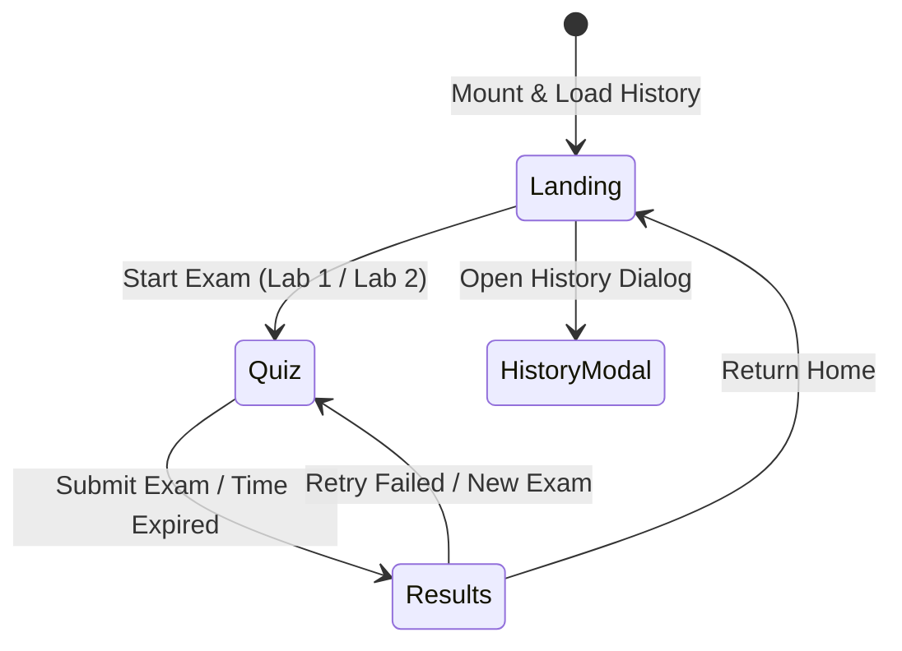

# Architecture Documentation

> **Distributed Systems Exam Prep Platform (PrepLab)**  
> Technical Architecture, Two-Layer Visual System, State Management, and Data Pipelines.

---

## 1. High-Level Architecture Overview

```
┌────────────────────────────────────────────────────────────────────────┐
│                        AppShell Container                              │
│                                                                        │
│   ┌──────────────────┐   ┌─────────────────────────────────────────┐   │
│   │   InsetSidebar   │   │              InsetTopbar                │   │
│   │  (Liquid Glass)  │   │            (Liquid Glass)               │   │
│   └────────┬─────────┘   └────────────────────┬────────────────────┘   │
│            │                                  │                        │
│            └───────────────┬──────────────────┘                        │
│                            │                                           │
│            ┌───────────────▼──────────────────────────┐                │
│            │             Active Screen                │                │
│            │  (LandingScreen / QuizScreen / Results)  │                │
│            │      [Solid Opaque Venus Cards]          │                │
│            └──────────────────────────────────────────┘                │
│                                                                        │
│   ┌────────────────────────────────────────────────────────────────┐   │
│   │       MobileNavPill (Fixed bottom floating glass on mobile)    │   │
│   └────────────────────────────────────────────────────────────────┘   │
└────────────────────────────────────────────────────────────────────────┘
```

The application is structured into two visual and functional layers:
1. **Chrome Layer (Apple Liquid Glass)**: Translucent, floating navigation surfaces (`InsetSidebar`, `InsetTopbar`, `MobileNavPill`, `ModalSheet`) that sit at z-index 100+ over the canvas.
2. **Content Layer (Venus Soft-UI)**: Solid, high-contrast, fully opaque cards (`LandingScreen`, `QuizScreen`, `ResultsScreen`) that ensure $> 7:1$ contrast ratio for questions, code blocks, and metrics.

---

## 2. Component Hierarchy Tree

```
src/
├── main.tsx                         # React 18 DOM mount point & initial theme load
├── App.tsx                          # Core quiz state machine & session management
├── components/
│   ├── AmbientBackground.tsx        # Canvas background mesh with organic animated blobs
│   ├── GlassSurface.tsx             # Foundational 6-layer optical glass material container
│   ├── LandingScreen.tsx            # Venus mode selection cards, metric badges & SVG sparklines
│   ├── QuizScreen.tsx               # 20-pill glass navigator, timer pill & solid question card
│   ├── ResultsScreen.tsx            # Circular gauge score hero, review deck & retry actions
│   ├── HistoryModal.tsx             # Attempt history, score trends & weakness breakdown
│   ├── shell/
│   │   ├── AppShell.tsx             # Layout manager handling responsive sidebar & topbar
│   │   ├── InsetSidebar.tsx         # Desktop floating inset glass sidebar
│   │   ├── InsetTopbar.tsx          # Floating topbar with breadcrumbs & actions
│   │   └── MobileNavPill.tsx        # Floating bottom navigation pill for mobile viewports
│   ├── primitives/
│   │   ├── Button.tsx               # Accessible Soft-UI and glass button with spring tactile press
│   │   ├── IconButton.tsx           # Touch-expanded accessible icon button
│   │   ├── Badge.tsx                # Status tags & category chips
│   │   ├── SegmentedControl.tsx     # Apple-style sliding pill tab control
│   │   ├── TextInput.tsx            # Styled search & input field
│   │   ├── ModalSheet.tsx           # Accessible modal with focus trap & backdrop scrim
│   │   └── Icons.tsx                # Zero-overhead inline SVG icon collection (Lucide-inspired)
│   └── charts/
│       ├── RoundedBarChart.tsx      # Pure SVG vertical bars with rx="10" & highlighted bar
│       ├── AreaSparkline.tsx        # Smooth cubic Bézier spline curve ($C_1, C_2$) with gradient
│       └── CircularGauge.tsx        # Circular SVG score gauge with dynamic stroke-dashoffset
├── data/
│   ├── lab1.ts                      # 260 verified Lab 1 Dockerization questions
│   ├── lab2.ts                      # 260 verified Lab 2 gRPC & Concurrency questions
│   └── index.ts                     # Dynamic code-split loaders (loadLab1Questions, loadLab2Questions)
├── services/
│   ├── theme.ts                     # Theme persistence ('light' | 'dark') and system listener
│   ├── storage.ts                   # LocalStorage adapters for attempts and active quiz recovery
│   └── sampling.ts                  # Weighted sampling engine (unseen 3.0x, wrong 2.5x, correct 1.0x)
└── styles/
    ├── tokens/
    │   ├── venus-tokens.css         # Soft-UI colors, spacing, typography, and card shadows
    │   └── glass-tokens.css         # Optical recipe variables, blurs, specular rims, and spring tokens
    ├── glass-surface.css            # 6-layer optical glass CSS implementation
    ├── ambient-background.css       # Hardware-accelerated ambient gradient mesh
    ├── motion.css                   # Spring curves, hover micro-lifts, and reduced-motion killswitch
    ├── hardening.css                # Focus visible rings, touch targets, and forced-colors modes
    └── theme.css                    # Unified design tokens & component style master manifest
```

---

## 3. State Machine & Session Lifecycle

The primary application state lives in `src/App.tsx` and transitions cleanly between 3 core screens:



### Session Recovery
- On every answer change or question navigation in `QuizScreen`, the active state is debounced and serialized to `localStorage` under `PREPLAB_ACTIVE_SESSION`.
- If the browser tab is refreshed or reopened, `App.tsx` detects the unfinished attempt, calculates the elapsed time against `Date.now()`, and presents an option to resume or discard.

---

## 4. Zero-Dependency SVG Chart Architecture

To respect the strict bundle limit ($< 200\text{ KB}$ gzipped), third-party charting libraries (Recharts, Chart.js) were deliberately excluded.
Charts are generated using pure mathematical SVG paths:
- **`RoundedBarChart`**: Computes SVG `<rect>` elements with `rx="10"` and `ry="10"`, highlighting the peak bar with `--venus-primary-indigo` and inactive bars with `--venus-chart-bar-inactive`.
- **`AreaSparkline`**: Uses cubic Bézier control points ($C_1 = (x_0 + \Delta x / 2, y_0)$, $C_2 = (x_1 - \Delta x / 2, y_1)$) to create an organic, smooth curve with an SVG linear gradient area fill.
- **`CircularGauge`**: Computes circumference $C = 2\pi r$ and animates `strokeDashoffset = C \times (1 - p / 100)` using hardware-accelerated SVG transitions.

---

## 5. Security & Build Budgets
- **Static Delivery**: No backend server or database required.
- **Strict Content Security**: Zero external script dependencies; fonts delivered via standard Google CDN with local fallback.
- **Production Footprint**:
  - Main JS bundle: **61.00 KB gzipped**
  - Main CSS bundle: **11.50 KB gzipped**
  - Lab 1 data chunk (dynamic): **59.05 KB gzipped**
  - Lab 2 data chunk (dynamic): **65.83 KB gzipped**
  - Total initial payload: $\sim 72.5\text{ KB}$ gzipped.
