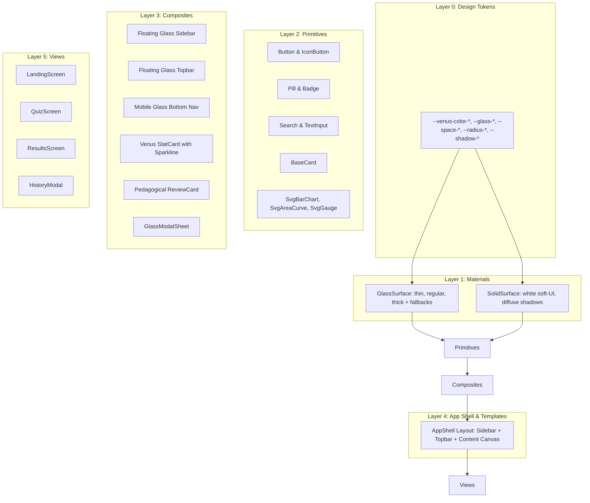

# Inception: Application Architecture & UI Design Specification

## 1. Design System Layer Architecture

The design system is structured into 6 strictly unidirectional layers. Higher layers may only consume tokens and components from lower layers:



---

## 2. Elevation & Z-Index Stack

```text
  Z-INDEX  LAYER                   MATERIAL                 EXAMPLES
  ───────  ──────────────────────  ───────────────────────  ───────────────────────────────────
  1000     Overlays & Dialogs      Thick Glass (28px blur)  HistoryModal, Submit Confirmation
   900     Toasts & Floating FABs  Thick Glass + Glow       Alert toasts, floating action pills
   500     Sticky / Floating Nav   Regular Glass (18px)     Inset Topbar, Desktop Sidebar, Mobile Pill
   100     Active Segmented Pills  Thin Glass (8px)         Timer pill, category filter tracks
     1     Primary Content Layer   SOLID Venus White Cards  Practice cards, questions, charts, reviews
     0     Ambient Base Canvas     Canvas + Mesh Gradients  Light #F4F7FE + soft blurred indigo/coral orbs
```

---

## 3. Information Architecture & Navigation Map

```mermaid
graph LR
    subgraph Global_Shell [App Shell]
        Sidebar[Glass Sidebar]
        Topbar[Glass Topbar]
        ThemeToggle[Theme Switcher]
        HistoryButton[History Launcher]
    end

    subgraph Screen_Landing [Landing Screen]
        ModeCards[P1 / P2 / Mixed Mode Cards]
        TimerConfig[Timer Segmented Selector]
        ResumeCard[Active Session Resume Banner]
    end

    subgraph Screen_Quiz [Quiz Screen]
        PillNav[20-Question Status Pill Bar]
        ActiveTimer[Floating Timer Pill]
        QuestionCard[Solid Question & Options Card]
        SubmitAction[Submit Exam Modal Sheet]
        QuitAction[Quit Exam Modal Sheet]
    end

    subgraph Screen_Results [Results Screen]
        ScoreHero[Circular Score Meter & Badges]
        QuickStats[4 Venus Stat Cards]
        WeaknessChart[Topic Mastery SVG Bar Chart]
        FilterBar[Review Filter Segmented Pills]
        ReviewList[Itemized Question Review Cards]
        RetryAction[Reintentar Falladas Action]
    end

    subgraph Modal_History [History Modal]
        HistoryTab[Attempt Log Table]
        WeaknessTab[Topic Mastery Breakdown Table]
        ClearHistory[Purge Confirmation Action]
    end

    Sidebar -->|Navigate| Screen_Landing
    Sidebar -->|Open| Modal_History
    Topbar --> ThemeToggle
    Topbar --> HistoryButton --> Modal_History
    Screen_Landing -->|Start / Resume| Screen_Quiz
    Screen_Quiz -->|Complete / Auto-submit| Screen_Results
    Screen_Results -->|Retry Wrong| Screen_Quiz
    Screen_Results -->|New Attempt| Screen_Landing
```



---

## 4. UI Wireframes & Layout Geometry

### 4.1 Desktop App Shell & Landing Screen (1440px)

```text
+---------------------------------------------------------------------------------------------------------+
| [⚡ PrepLab SSDD]                     (Floating Inset Glass Topbar)            [☀️/🌙] [📊 Historial]   |
+---------------------------------------------------------------------------------------------------------+
| +-------------------+  +-------------------------------------------------------------------------------+ |
| | (Floating Inset   |  |                                                                               | |
| |  Glass Sidebar)   |  |  ¡Hola, Estudiante! 👋                                                        | |
| |                   |  |  Prepárate para el Examen de Laboratorio de Sistemas Distribuidos             | |
| | 🏠 Simulacros     |  |                                                                               | |
| | 📊 Historial      |  |  +---------------------+  +---------------------+  +---------------------+    | |
| | 🎯 Debilidades    |  |  | [🐳] Práctica 1     |  | [⚡] Práctica 2      |  | [🔀] Examen Mixto   |    | |
| | ⚙️ Ajustes        |  |  | Docker & .NET 10    |  | gRPC & Concurrencia |  | 520 Preguntas       |    | |
| |                   |  |  | 260 Preguntas       |  | 260 Preguntas       |  | P1 + P2 Combinadas  |    | |
| |                   |  |  +---------------------+  +---------------------+  +---------------------+    | |
| |                   |  |                                                                               | |
| |                   |  |  TEMPORIZADOR DEL EXAMEN:                                                     | |
| |                   |  |  [ Sin límite ] [ 10m ] [ (20 min) ] [ 30m ] [ 45m ] [ 60m ] [ Personalizado ] | |
| |                   |  |                                                                               | |
| |                   |  |  +-------------------------------------------------------------------------+  | |
| |                   |  |  |              🚀 COMENZAR SIMULACRO (20 PREGUNTAS)                       |  | |
| |                   |  |  +-------------------------------------------------------------------------+  | |
| +-------------------+  +-------------------------------------------------------------------------------+ |
+---------------------------------------------------------------------------------------------------------+
```

### 4.2 Quiz Screen (1440px & 375px)

```text
+---------------------------------------------------------------------------------------------------------+
| [⚡ PrepLab]  Pregunta 4 de 20 • [Docker Networking] [Media]                 ⏱️ [ 16:42 ] (Glass Pill)  |
+---------------------------------------------------------------------------------------------------------+
|   (Glass Pill Bar)  [1✓] [2✓] [3✓] [ 4* ] [5] [6🚩] [7] [8] [9] [10] [11] ... [20]                     |
|                                                                                                         |
|   +-------------------------------------------------------------------------------------------------+   |
|   | (Solid Venus White Card)                                                                        |   |
|   | ¿Qué flag de 'docker run' se debe utilizar para mapear el puerto 8080 del host                  |   |
|   | al puerto 80 del contenedor en una red tipo bridge?                                             |   |
|   |                                                                                                 |   |
|   |   (A)  --network host                                                                           |   |
|   |   (B)  -p 8080:80              [✓ SELECCIONADA - BORDE ÍNDIGO ACTIVO]                           |   |
|   |   (C)  -v 8080:80                                                                               |   |
|   |   (D)  --expose 8080                                                                            |   |
|   +-------------------------------------------------------------------------------------------------+   |
|                                                                                                         |
|   [ Anterior ]      [ 🚩 Marcar para revisar ]      [ Siguiente ]            [ 📥 Entregar Examen ]     |
+---------------------------------------------------------------------------------------------------------+
```

### 4.3 Results Screen (1440px)

```text
+---------------------------------------------------------------------------------------------------------+
| +-----------------------------------------------------------------------------------------------------+ |
| | (Solid Venus Score Card with Gradient & Gauge)                                                      | |
| |       (@ Gauge 85%)          ¡EXCELENTE TRABAJO, PRUEBA SUPERADA!                                   | |
| |          17 / 20             Criterio de aprobado oficial: ≥ 50% (Tu nota: 85%)                     | |
| |                                                                                                     | |
| |   [ Modo: P1 Docker ]   [ Tiempo: 12m 34s ]   [ Aciertos: 17 ]   [ Fallos: 3 ]                      | |
| |                                                                                                     | |
| |   [ 🔄 Reintentar 3 preguntas falladas ]   [ 🚀 Nuevo simulacro ]   [ 📊 Ver Analítica Completa ]   | |
| +-----------------------------------------------------------------------------------------------------+ |
|                                                                                                         |
| REVISIÓN DETALLADA DE PREGUNTAS:                                                                        |
| [ (Todas: 20) ]  [ Solo Falladas: 3 ]  [ Acertadas: 17 ]  (Segmented Glass Pill Track)                   |
|                                                                                                         |
| +-----------------------------------------------------------------------------------------------------+ |
| | (Review Card 1 - Incorrect) ✗ Fallada                                      Pregunta 4 • Docker Net  | |
| | ¿Qué flag de 'docker run' se debe utilizar...?                                                      | |
| |   (A) --network host                                                                                | |
| |   (B) -p 8080:80          ✓ Respuesta correcta                                                      | |
| |   (C) -v 8080:80          ✗ Tu elección errónea                                                     | |
| |   (D) --expose 8080                                                                                 | |
| |                                                                                                     | |
| | +-------------------------------------------------------------------------------------------------+ | |
| | | 💡 JUSTIFICACIÓN TÉCNICA Y ANÁLISIS DE DISTRACTORES:                                            | | |
| | | Por qué es correcta (B): El flag -p o --publish publica el puerto del host al contenedor...     | | |
| | | Por qué es incorrecta (C): El flag -v se utiliza para vincular volúmenes o bind mounts...       | | |
| | | Por qué es incorrecta (A): --network host deshabilita el aislamiento de red del contenedor...   | | |
| | | Por qué es incorrecta (D): EXPOSE es puramente informativo y no publica el puerto en el host... | | |
| | +-------------------------------------------------------------------------------------------------+ | |
| +-----------------------------------------------------------------------------------------------------+ |
+---------------------------------------------------------------------------------------------------------+
```
