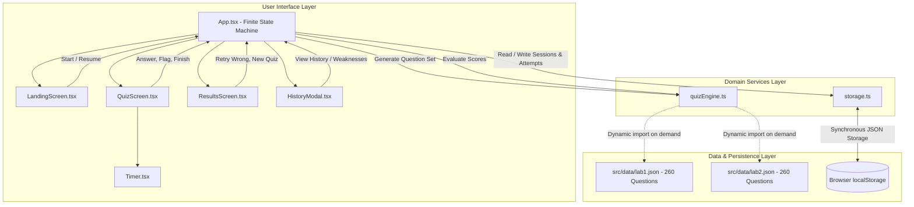
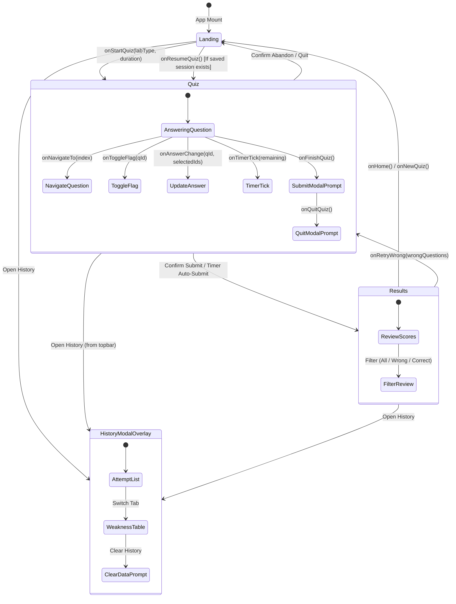

# Reverse Engineering: Architecture & Data Flow

## 1. System Topology Overview

The application is a single-page web application (SPA) built on **React 18.3**, **TypeScript 5.6**, and **Vite 5.4**. It operates as a 100% client-side, zero-backend, statically deployable architecture hosted on Vercel.

---

## 2. Finite State Machine (Screen Lifecycle)

The root state machine resides in `src/App.tsx`:

---

## 3. Data Flow & State Contracts

### 3.1 Question Bank Streaming (Lazy Chunks)
To satisfy the <200 KB initial bundle budget, `lab1.json` (260 questions) and `lab2.json` (260 questions) are dynamically loaded via `import('../data/lab1.json')` and `import('../data/lab2.json')` only when the user starts a quiz. They are cached in-memory in `quizEngine.ts`.

### 3.2 Sampling Algorithm
`selectQuestions(labType, count)` applies a weighted sampling algorithm without replacement:
- **Unseen questions** (never attempted): weight **3.0**
- **Previously incorrect questions**: weight **2.5**
- **Previously correct questions**: weight **1.0**
- Fisher-Yates shuffle is executed on both the selected question set and each question's `options` array.

### 3.3 Timer Synchronization & Resilience
Rather than relying on naive `setInterval` countdowns that freeze when the browser tab is backgrounded, `Timer.tsx` and `storage.ts` store `timerStartedAtTimestamp` (epoch ms) and `initialDurationSeconds`. Upon re-render or page reload, elapsed time is computed as:
$$\text{elapsed} = \lfloor(\text{Date.now()} - \text{timerStartedAtTimestamp}) / 1000\rfloor$$
$$\text{remaining} = \max(0, \text{initialDurationSeconds} - \text{elapsed})$$

### 3.4 Local Storage Schema
| Key | Type | Purpose |
| :--- | :--- | :--- |
| `ds_quiz_username` | `string` | Display name for student attempts. |
| `ds_quiz_active_session` | `QuizSessionState` | JSON serialization of active exam, answers, flags, and timestamp. |
| `ds_quiz_attempt_history` | `AttemptResult[]` | Array of completed attempts (max 100 entries). |
| `ds_quiz_timer_preset` | `number` | Preset in seconds (0, 600, 1200, 1800, 2700, 3600). |
| `ds_quiz_custom_timer_minutes`| `number` | Custom countdown minutes when preset is overridden. |
