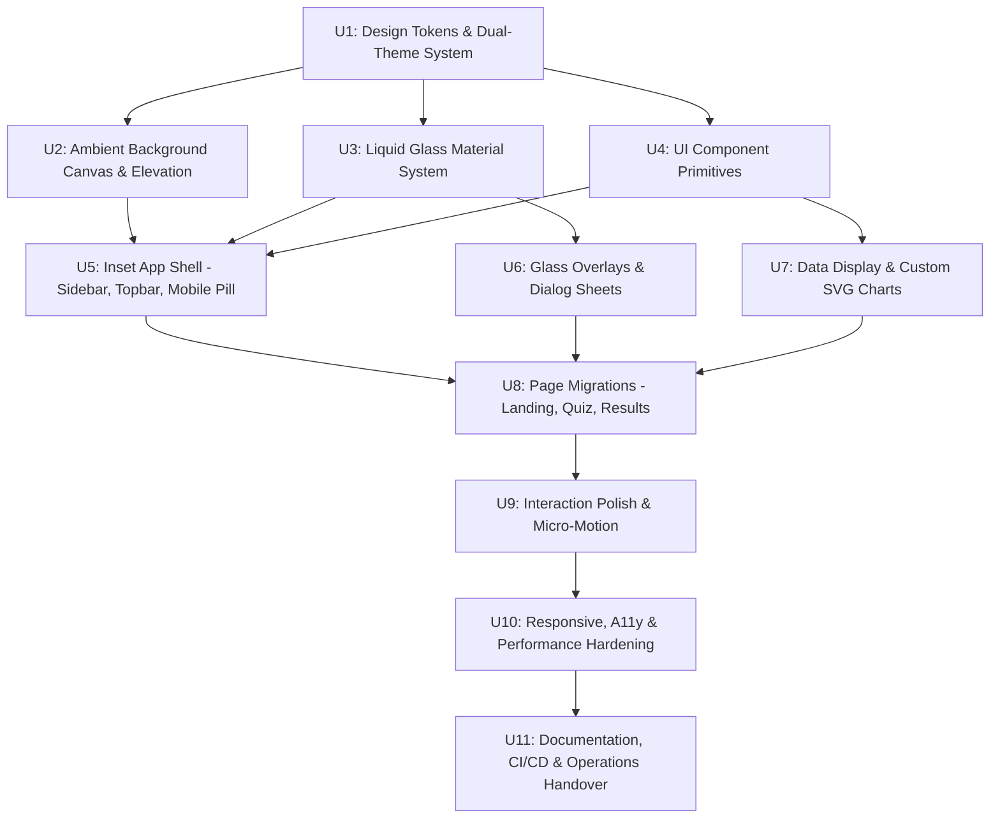

# Inception: Units of Work (Decomposition & Dependency Graph)

## 1. Overview of Shippable Units

The redesign is decomposed into 11 independently shippable and verifiable units of work (U1 through U11). Each unit represents an atomic architectural capability delivered with test coverage, zero regression, and documentation.

### Critical Path:
`U1 (Tokens) → U3 (Glass Material) → U5 (App Shell) → U8 (Page Migrations) → U10 (A11y/Perf) → U11 (Release)`

---

## 2. Unit Catalog & Story Mapping

### Unit U1: Design Tokens & Dual-Theme System
- **Scope**: Centralized CSS custom property system: Venus light palette, deep dark palette, 8px spatial grid, radii (12/16/20/24px), diffuse shadows, typography scale (incorporating `Poppins`), and theme switching mechanism (`data-theme`).
- **Dependencies**: None.
- **Risk**: Low.
- **Stories**: `US-001`, `US-002`.
- **Exit Criteria**: All colors, fonts, and spaces accessible via CSS variables; theme toggle flips variables with zero layout shift.

### Unit U2: Ambient Background Layer & Elevation
- **Scope**: Base canvas styling (`#F4F7FE`) with three fixed, low-cost radial gradient ambient orbs (indigo, purple, coral) positioned to feed glass refraction without GPU jank.
- **Dependencies**: `U1`.
- **Risk**: Low.
- **Stories**: `US-001`.
- **Exit Criteria**: Ambient background visible behind main layout; zero scroll jank (60fps); static fallback under `prefers-reduced-motion`.

### Unit U3: Liquid Glass Material System
- **Scope**: Reusable `GlassSurface` component/utility implementing the 6-layer optical recipe: backdrop blur + saturation, translucent fill, 1px specular border, inset inner reflection, surface sheen, and soft tinted drop shadow. Three tiers: `thin` (8px), `regular` (18px), `thick` (28px).
- **Dependencies**: `U1`.
- **Risk**: High (cross-browser rendering, performance).
- **Stories**: `US-001`, `US-012`, `US-013`.
- **Exit Criteria**: Renders authentic glass optics; passes 4.5:1 contrast against worst-case backdrops; degrades cleanly under `@supports not (backdrop-filter)` and `prefers-reduced-transparency`.

### Unit U4: UI Component Primitives
- **Scope**: Core accessible primitives built on Venus tokens: `Button` (primary indigo, secondary ghost, danger), `IconButton` with glowing hover, `Pill` / `Badge`, `SegmentedControl`, and `TextInput`.
- **Dependencies**: `U1`.
- **Risk**: Low.
- **Stories**: `US-001`, `US-003`, `US-005`.
- **Exit Criteria**: High-contrast `:focus-visible` rings, active scale-down (0.97), ARIA attributes, 100% keyboard accessible.

### Unit U5: Inset App Shell (Sidebar, Topbar & Mobile Nav)
- **Scope**: Floating inset glass topbar (PrepLab branding, status badge, theme toggle, history button) + floating desktop sidebar (Simulacros, Historial, Debilidades, Ajustes) + mobile bottom glass drawer.
- **Dependencies**: `U2`, `U3`, `U4`.
- **Risk**: Medium (responsive layout, z-index stacking).
- **Stories**: `US-001`, `US-002`.
- **Exit Criteria**: Inset layout with content scrolling visibly beneath; smooth transition between desktop sidebar and mobile bottom pill; zero horizontal overflow.

### Unit U6: Glass Overlays & Modal Sheets
- **Scope**: Overhauling modal dialogs (`HistoryModal`, quiz submit confirmation, quit confirmation) into thick-glass floating sheets elevated over a lightly dimmed, non-blurred scrim to prevent nested blur stacking bugs.
- **Dependencies**: `U3`, `U4`.
- **Risk**: Medium (focus trapping, Safari blur bugs).
- **Stories**: `US-004`, `US-007`, `US-011`.
- **Exit Criteria**: Focus trapped within open modal; Escape key closes dialog; zero nested backdrop-filter defects; glass surface area within budget.

### Unit U7: Data Display & Custom SVG Charts
- **Scope**: Zero-dependency SVG visual components (< 5 KB total): rounded-top bar chart with 1 highlighted indigo bar, smooth spline area curve with gradient fill, and circular score meter with radial progress arc.
- **Dependencies**: `U1`, `U4`.
- **Risk**: Low.
- **Stories**: `US-008`, `US-011`.
- **Exit Criteria**: Pure React SVG rendering without external libraries; fluid responsive resizing; screen-reader accessible with ARIA labels.

### Unit U8: Screen Migrations
- **Scope**: Upgrading the 3 primary screens:
  - **U8.1**: Landing Screen (Venus mode selection cards, glass timer control, resume banner).
  - **U8.2**: Quiz Screen (20-pill glass navigator, solid question/choice cards, floating timer pill).
  - **U8.3**: Results Screen (score hero gauge, Venus stat cards, distractor review cards, retry wrong button).
- **Dependencies**: `U5`, `U6`, `U7`.
- **Risk**: High (must guarantee zero regression of existing 520 questions and scoring logic).
- **Stories**: `US-003` through `US-010`.
- **Exit Criteria**: 100% functional equivalence with existing state machine; all existing features and edge cases pass automated characterization tests.

### Unit U9: Interaction Polish & Micro-Motion
- **Scope**: Spring-like Bezier curves (`cubic-bezier(0.16, 1, 0.3, 1)`), hover lifts, tactile active presses, smooth filter tab indicator sliding, celebratory pass animation.
- **Dependencies**: `U8`.
- **Risk**: Low.
- **Stories**: `US-001`, `US-003`, `US-008`.
- **Exit Criteria**: Transitions complete within 150–250ms; instant state transitions under `prefers-reduced-motion`.

### Unit U10: Responsive, Accessibility & Performance Hardening
- **Scope**: Comprehensive validation: Lighthouse CI audits, Axe-core accessibility scans, 375px–1920px responsive tests, mobile thermal blur reduction, worst-case backdrop contrast proof, and cross-browser visual checks.
- **Dependencies**: `U9`.
- **Risk**: Medium.
- **Stories**: `US-012`, `US-013`.
- **Exit Criteria**: Initial JS bundle < 200 KB gzipped; LCP < 2.5s; 0 Axe accessibility violations; 60 fps scrolling confirmed.

### Unit U11: Documentation, CI/CD & Operations Handover
- **Scope**: Final documentation (`DESIGN_SYSTEM.md`, `GLASS_MATERIAL_GUIDE.md`, updated `README.md`, `ARCHITECTURE.md`), ADR index, and deployment readiness review for Vercel.
- **Dependencies**: `U10`.
- **Risk**: Low.
- **Exit Criteria**: All docs complete; Vercel deployment preview verified.
