# Inception: Workflow Plan & Execution Bolts

## 1. Execution Philosophy

To maintain continuous delivery, zero regression, and clear governance, the Construction Phase is organized into **11 ordered bolts** (Bolt 1 through Bolt 11). Each bolt is strictly $\le 1$ unit of work, concludes with an automated build and test pass, and requires a human gate review (Gate 3) before advancing to the next bolt.

```mermaid
graph LR
    B1[Bolt 1: Tokens & Theme] --> B2[Bolt 2: Ambient Canvas]
    B2 --> B3[Bolt 3: Glass Material]
    B3 --> B4[Bolt 4: Primitives]
    B4 --> B5[Bolt 5: App Shell]
    B5 --> B6[Bolt 6: Overlays & Modals]
    B6 --> B7[Bolt 7: SVG Charts]
    B7 --> B8[Bolt 8: Screen Migrations]
    B8 --> B9[Bolt 9: Motion & Polish]
    B9 --> B10[Bolt 10: Hardening]
    B10 --> B11[Bolt 11: Release & Docs]
```

---

## 2. Bolt Breakdown & Entry/Exit Criteria

### Bolt 1: Design Tokens & Dual-Theme System (`U1`)
- **Effort**: 3 hours
- **Entry Criteria**: Inception Phase approved (Gate 1).
- **Deliverables**:
  - `src/styles/tokens/venus.css` (colors, spacing, typography, radii, shadows).
  - `src/styles/tokens/glass.css` (blur levels, opacities, specular borders, sheen gradients).
  - Theme switching logic (`data-theme="light"` / `data-theme="dark"`).
- **Exit Criteria**: CSS variables available globally; light and dark modes toggleable with zero layout shift; `npm run build` succeeds.

### Bolt 2: Ambient Background Layer (`U2`)
- **Effort**: 2 hours
- **Entry Criteria**: Bolt 1 approved.
- **Deliverables**:
  - `src/components/AmbientBackground.tsx` and accompanying CSS.
  - Three GPU-cheap radial gradient meshes (indigo, purple, coral) positioned at $z=0$.
  - Media query disabling motion/parallax under `prefers-reduced-motion`.
- **Exit Criteria**: Canvas renders softly behind layout; DevTools confirms 60 fps scrolling with zero GPU thermal overhead.

### Bolt 3: Liquid Glass Material System & Fallbacks (`U3`)
- **Effort**: 4 hours
- **Entry Criteria**: Bolt 2 approved.
- **Deliverables**:
  - `src/components/GlassSurface.tsx` with variants (`thin`, `regular`, `thick`) and tones (`light`, `dark`, `accent`).
  - Full 6-layer optical recipe (blur + saturate, tinted fill, specular rim, inner reflection, sheen, layered shadow).
  - Complete fallbacks for `@supports not (backdrop-filter)`, `prefers-reduced-transparency`, and `forced-colors`.
- **Exit Criteria**: Glass surfaces pass $\ge 4.5:1$ text contrast test against worst-case backdrops; fallbacks verified under simulated reduced transparency.

### Bolt 4: Accessible UI Primitives (`U4`)
- **Effort**: 4 hours
- **Entry Criteria**: Bolt 3 approved.
- **Deliverables**:
  - `Button.tsx`, `IconButton.tsx`, `Pill.tsx`, `SegmentedControl.tsx`, `TextInput.tsx`.
  - Spring-like active states (scale 0.97), high-contrast `:focus-visible` offset rings, ARIA roles.
- **Exit Criteria**: All primitives 100% keyboard operable; unit test suite passes with 0 failures.

### Bolt 5: Inset App Shell Layout (`U5`)
- **Effort**: 5 hours
- **Entry Criteria**: Bolt 4 approved.
- **Deliverables**:
  - `src/components/AppShell.tsx`: Desktop floating inset glass sidebar + floating inset glass topbar + mobile bottom pill.
  - Brand badge with illuminated glow, theme toggle trigger, and active navigation indicator.
- **Exit Criteria**: Responsive transition between desktop sidebar (1024px+) and mobile bottom pill (<768px); zero horizontal overflow; content scrolls beneath glass chrome.

### Bolt 6: Overlays & Modal Sheets (`U6`)
- **Effort**: 4 hours
- **Entry Criteria**: Bolt 5 approved.
- **Deliverables**:
  - `HistoryModal.tsx` upgraded to thick-glass sheet over semi-opaque non-blurred scrim.
  - Submit confirmation dialog and Quit confirmation dialog migrated to thick-glass sheets.
  - Focus trapping and Escape key dismiss behavior.
- **Exit Criteria**: Zero nested `backdrop-filter` rendering glitches; focus trapped inside modal; glass area within budget.

### Bolt 7: Data Display & Custom SVG Charts (`U7`)
- **Effort**: 4 hours
- **Entry Criteria**: Bolt 6 approved.
- **Deliverables**:
  - `SvgBarChart.tsx`: Rounded-top bar chart with 1 highlighted indigo bar.
  - `SvgAreaCurve.tsx`: Smooth cubic spline area chart with gradient fade.
  - `SvgGauge.tsx`: Circular score meter with radial progress arc.
- **Exit Criteria**: Zero external chart dependencies (<5 KB total SVG code); fluid resizing; screen-reader accessible with ARIA attributes.

### Bolt 8: Screen Migrations (`U8`)
- **Effort**: 6 hours
- **Entry Criteria**: Bolt 7 approved.
- **Deliverables**:
  - **B8.1**: Landing Screen migration (Venus mode cards, timer segmented control, resume banner).
  - **B8.2**: Quiz Screen migration (20-pill glass navigator, solid question/choice cards, floating timer pill).
  - **B8.3**: Results Screen migration (score hero gauge, Venus stat cards, distractor review cards, retry wrong button).
- **Exit Criteria**: 100% functional equivalence with existing state machine; characterization tests confirm zero regressions in scoring, question sampling, or session recovery.

### Bolt 9: Interaction Polish & Micro-Motion (`U9`)
- **Effort**: 3 hours
- **Entry Criteria**: Bolt 8 approved.
- **Deliverables**:
  - Spring-like transitions (`cubic-bezier(0.16, 1, 0.3, 1)`), hover lifts, active tactile feedback, smooth filter tab sliding indicator.
  - Immediate state transitions under `prefers-reduced-motion`.
- **Exit Criteria**: Fluid 60 fps transitions; zero motion when reduced motion is preferred.

### Bolt 10: Responsive, A11y & Performance Hardening (`U10`)
- **Effort**: 4 hours
- **Entry Criteria**: Bolt 9 approved.
- **Deliverables**:
  - Viewport verification at 375px, 768px, 1024px, 1440px, and 1920px.
  - Axe-core full scan (0 Critical / 0 Serious violations).
  - Worst-case glass contrast matrix proof.
  - Production build audit: Initial JS bundle strictly $< 200\text{ KB}$ gzipped.
- **Exit Criteria**: All quality gate thresholds met 100%.

### Bolt 11: Documentation & Operations Handover (`U11`)
- **Effort**: 2 hours
- **Entry Criteria**: Bolt 10 approved.
- **Deliverables**:
  - `DESIGN_SYSTEM.md`, `GLASS_MATERIAL_GUIDE.md`, updated `README.md`, `ARCHITECTURE.md`.
  - Vercel deployment preview check and final release notes.
- **Exit Criteria**: Complete documentation; ready for production deployment.

---

## 3. Stages Skipped with Justification

- **No stages skipped**: The full pipeline from token definition, material abstraction, primitive construction, shell integration, view migration, to accessibility hardening is executed in complete sequence to guarantee architectural integrity.
